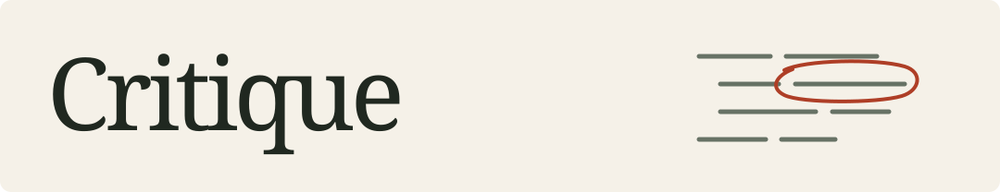

A review skill for code and system designs. Each finding traces a failure to its cause, cites the evidence, and recommends a fix. The review also tells you what it couldn't verify.

## Install for Codex

```sh
git clone https://github.com/PyModel/critique.git ~/.agents/skills/critique
```

Open Codex in the project you want to review and try this prompt.

> $critique Review the payout worker. If the bank accepts a transfer but the response times out, can a retry pay the seller twice?

Ask for a patch when you want replacement code, or an exhaustive review when you want every file accounted for.

[Review rules](SKILL.md) · [Extension guide](HOW_TO_EXTEND.md) · [Evaluation results](evals/README.md)
